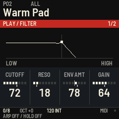
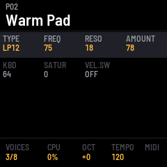

# SY1

A polysynth for the [M-VAVE FM-1](https://github.com/m-vave/fm1_open) that plays **Synth1 patches** (`.sy1`).

**[Website](https://fenderberg.github.io/fm1-sy1/)** · [Try it in the browser](https://fenderberg.github.io/fm1-sy1/emu/) · [Install](https://fenderberg.github.io/fm1-sy1/install/) · [Patch Manager](https://fenderberg.github.io/fm1-sy1/manager/) · [Manual](https://fenderberg.github.io/fm1-sy1/manual/)

Two oscillators and a sub, FM / ring / sync, four filter types, three envelopes, two LFOs, arpeggiator,
unison, ten effects, EQ, tempo delay and chorus: Synth1's 99 parameters, under Synth1's own numbers, so its
patches load as they are. Every parameter can also be edited on the FM-1 itself.

 

SY1 is built on [fm1-base](https://github.com/charlesvestal/fm1-base). Its parameter laws (envelope times,
filter curves, FM index and the rest) are the measurements of the original Synth1 published by
[oxo_synth2](https://github.com/chab/oxo_synth2) (MIT). See [THIRD_PARTY.md](THIRD_PARTY.md).

SY1 is not affiliated with or endorsed by Daichi Laboratory. It contains nothing of Synth1 itself and ships
no third-party patches.

## Status: early

| Part | State |
| --- | --- |
| Engine (`app/dsp/`) | Works; tested on the host: `make test` |
| `.sy1` reader, old versions too (ver < 109) | Works; tested in C and in JavaScript against each other |
| App: screen, panel, keys, MIDI, patch storage | Passes in fm1-base's simulator (`app/tests/basic.txt`) and in `make test-app` |
| Browser emulator with a patch loader | Works: drop `.sy1` files or a `.zip` bank on the page |
| Firmware (`./build.sh`) | Builds; installs and runs on one FM-1 (driven over USB with `base/tools/fm1_remote.py`) |
| Voices on the FM-1 | About 7 on one core: a plain voice costs about 10 % of the render's time, a detuned one with chorus about 12 %. The second core is not used yet |
| Sound on the FM-1, and compared with the original Synth1 | **Not judged yet** |
| Loading patches into a real FM-1 | Works with `tools/sy1_send.py` (tried with one patch) |

## Try it in the browser

```sh
git clone --recursive https://github.com/fenderberg/fm1-sy1 && cd fm1-sy1
./build.sh --web                                  # needs Emscripten (emcc) and Python with Pillow
python3 -m http.server 8471 --bind 127.0.0.1 --directory app/build/emu
```

Open <http://localhost:8471>, switch the FM-1 on, and drop your Synth1 patches on the page. Turn PRESETS
past the eight built-in patches to play them. The page loads the emulated FM-1 only; for a real one, see
below.

## Build and test

```sh
make test          # the engine: maths, tuning, envelopes, the patch reader, 400 random patches
make test-app      # the app against a stand-in for the FM-1
make test-web      # the page's patch reader against the C one (node)
make all           # build/s1render (a patch to a WAV file) and build/sy1pack (patches to a SysEx file)

./build.sh --host  # fm1-base's simulator, then:
app/build/host/sy1_host app/tests/basic.txt app/build/host
./build.sh         # the firmware: app/build/sy1.fwsc (JieLi toolchain and AC79 SDK: see base/README.md)
```

`build/s1render PATCH.sy1 out.wav -n 48,60,64,67 -hold 2 -tail 2` renders a patch with the engine exactly as
the FM-1 runs it.

## Patches on the FM-1

With the FM-1 running SY1 connected over USB:

```sh
make all                                     # once: builds build/sy1pack
tools/sy1_send.py folder/ bank.zip one.sy1   # .sy1 files, folders of them, .zip banks
tools/sy1_send.py --count                    # how many slots are in use
tools/sy1_send.py --erase                    # erase every loaded patch (the built-in ones stay)
```

The patches follow the ones already there (`--first N` chooses the slot). Each is acknowledged by the FM-1
before the next is sent. It needs Python with `mido` and `python-rtmidi`. The FM-1 holds 1024 patches; turn
PRESETS past `P08` to reach them.

`build/sy1pack bank.syx folder/*.sy1` writes the same frames to a SysEx file instead, for any SysEx tool
(leave 200 ms or more between messages: each is a write to the flash). The protocol is at the top of
[app/bank.h](app/bank.h).

## Controls

| Control | What it does |
| --- | --- |
| PRESETS / ALGORITHM | Patch ±1 / ±10. `P01`–`P08` are built in, `001`–`1024` are yours |
| HOME, EDIT, SEL, ENV, LFO, FX, ARP, GLO | Pages: Play, Osc, Filter, Env, LFO, Effects, Arp, Voice. Again: the next row |
| SELECT | Choose a row |
| KNOB1–4 | The chosen row's four values |
| SAVE | Save the patch (a built-in one goes to the first free slot) |
| SEQ | Undo the edits |
| PLAY | All notes off |
| OCT− / OCT+ | Octave |

MIDI in over USB and TRS: notes, pitch bend, the wheel and other controllers (as the patch routes them),
sustain pedal, aftertouch, program change (the patch) and MIDI clock (the tempo of the arpeggiator, the delay
and tempo-synced LFOs).

## How it differs from Synth1

The engine is a lighter reimplementation of the same structure, not a bit-exact copy. Simplified for the
FM-1 on purpose:

- Oscillators use polyBLEP instead of band-limited tables per note (no memory for the tables).
- Envelopes, LFOs, pitch and cutoff move at 1/16 of the sample rate, interpolated.
- The LPDL filter (type 4) plays as the 24 dB ladder; effect a.d.1 uses a.d.2's curve.
- Delay: 0.74 s a side at most (memory); longer times play an octave shorter. 16-bit storage.
- Delay and chorus together: the echoes also reach the output directly, not only through the chorus.
- Detune: osc1 gets its eight copies, the sub does not.
- Pitch bend and LFO pitch are not quantised to 1/128-octave steps.
- 8 voices by default (VOICE > VOICES, 1–16); on an overload one is dropped.

## Layout

```
app/dsp/              the engine: s1_synth (voices), s1_fx (effects), s1_patch (.sy1), s1_tables (generated)
app/app.c, bank.h     the FM-1 app; patch storage and the built-in patches
app/web/emu/app.js    the emulator page's patch loader
host/                 WAV renderer, patch packer, tests
tools/gen_tables.py   makes s1_tables.* and the loader's tables from oxo_synth2's measured tables
tools/sy1_send.py     sends patches to an FM-1 over USB MIDI
tools/publish_site.sh builds the site (app/site, app/docs) and pushes it to gh-pages
app/site/             the site's front page and the Patch Manager
base/                 fm1-base (git submodule)
```

## Licence

MIT: see [LICENSE](LICENSE). Third-party material keeps its own licence: [THIRD_PARTY.md](THIRD_PARTY.md).
