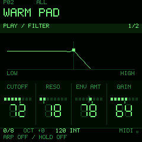

# SY1

SY1 is a polysynth for the M-VAVE FM-1 that plays Synth1 patches. This manual explains the screen, the pages,
how to get patches into the FM-1, and MIDI. Version **1.0.0** plays one sound, two (Bitimbral) or four (QUAD) at once, with the Circuit Tracks' macro knobs mapped on every part. It includes 256 community presets in all 13 sound categories, 1,024 user slots, a Patch Manager with more than 3,000 more sounds, and the NORD, GREEN LED and GREEN LCD display styles. What changed in each version: [What's new](../news/).

---

## Contents

1. Install
2. The screen
3. Patches
4. Pages and editing
5. Loading your own patches
6. MIDI
7. What differs from Synth1
8. Troubleshooting

---

## 1. Install

To try it first, open the emulator. It runs the same code in your browser, with sound.

To install, open the installer in Chrome or Edge with the FM-1 connected by USB, and follow it. Back up what
you want to keep from the firmware you have now: SY1 keeps its settings and patches in the same part of the
flash, and overwrites what another firmware left there. The installer can put M-VAVE's own firmware back.

After installation, this release reports the full USB identity **FM-1_51000301**.

## 2. The screen

The patch number, browsing category and patch name stay at the top. EDIT and the SAVE light mean that the
patch differs from the saved version. Turning every value and the patch category back to their saved settings
clears EDIT again. Short save and error messages appear in the red strip without hiding the patch name.

The red strip names the current subpage and its position, such as FILTER / MAIN 1/2. The large diagram below it
shows that section's settings. Four fixed columns correspond left to right to KNOB1–KNOB4. The last encoder
you turn lights amber; a small grey notch marks its saved value. A new subpage starts without encoder focus.
Switches and choices use separate positions; a centred parameter has a centre mark.

Filter shapes, oscillator waveforms and effect diagrams are schematic setting views. The envelope's moving point
follows the most recently started voice through its release, the LFO point follows its actual phase/value,
and the arp shows the current step/note. Random LFOs show recent values. These are not audio oscilloscopes.

Values use meaningful units where the engine supplies a reliable conversion: attack in ms or s, pitch in semitones
and cents, sustain in percent and LFO speed in Hz or exact fractions of a beat. D.TAU, R.TAU and M.TAU are decay
and release **time constants**, not the total duration of a note. Pulse width shows the duty of the low part
(50% at its maximum). Other values keep their Synth1 numbers. GLO's DIAGNOSTIC subpage (5/5) shows CPU,
peak CPU, voice-limit events and the raw value of the last edited Synth1 parameter. Its four encoders are read-only.

The bottom always shows active/max voices, octave, tempo and its source: INT for internal, EXT for MIDI clock.
MIDI lights briefly when a note arrives. The second line explicitly shows ARP ON/OFF, HOLD ON/OFF or
DRONE / STACK or REPLACE. LIMIT means that the CPU has reduced the voice limit during this session.

### Choosing a display style

On **GLO → SYSTEM (4/5)**, turn **KNOB2** to choose **NORD**, **GREEN** (LED) or **LCD**. The change is immediate.
NORD keeps the red section strip, ivory text and amber focus. GREEN LED uses a dark green background,
uppercase 5×7 pixel lettering and seven-segment numerals. GREEN LCD reverses the contrast with dark
characters and graphics on a soft green background; the focused control gets a lighter panel and dark
underline. Units, patch names, saved-value marks,
encoder focus, graphs, playing status and live envelope/LFO feedback remain available in all three styles.
The screen reader keeps the original text and announces the style choice.

The [screen gallery](https://fenderberg.github.io/fm1-sy1/manual/screens/) shows the display styles on the published firmware.

This is a global preference, separate from the sound. It is automatically saved when the synth is idle;
existing patch edits and imported banks are preserved. Upgrading from older 12-byte settings keeps the
selected patch, octave, voice limit, tempo, category and drone preference, and starts in NORD.

## 3. Patches

Turn ALGORITHM to choose a category, and PRESETS for the next or previous patch within it. Both wrap at the
ends. Empty categories are skipped. ALL contains every patch; USER contains every patch in the user bank. FACTORY contains the 256 bundled community presets.
The 13 sound categories are the Patch Manager's, in its order: BASS, PAD, LEAD, KEYS, PLUCK, ARP, DRUMS, STRINGS, BRASS, ORGAN, VOCAL, FX and OTHER. DRUMS covers drums and percussion,
BRASS brass and woodwinds, VOCAL voices and choirs. ALGORITHM steps ALL, the 13, USER, FACTORY.

**256 community presets are ready from the first boot**, numbered **F001–F256**. From ALL, turn
**ALGORITHM left once to FACTORY**, then use PRESETS. No import or USB transfer is needed.

Each factory preset has a category, and the bank is a cross-section of all 13: 22 each of Bass, Pad, Lead, Keys,
Pluck, Arp, Drums and Strings, 21 each of Brass, Organ and FX, 9 Vocal and 8 Other (chords, hits and poly
synths). They are numbered in that order: F001–F022 are basses, F023–F044 pads, and so on. A preset is only
included when its sound agrees with the category its name gives: a pad has a slow or long envelope, a pluck a
short decay, a drum a hit that dies away, an organ a note held at full level, an arpeggio the arpeggiator on.
At most two presets come from one name series (VOICES 001, 002 ...), so Vocal has fewer: the library has few
distinct voices. 211 of the 256 were not in the 0.4 factory bank. Turn ALGORITHM to a category to browse just
those, factory and your own.

These presets live in program flash and leave the 1,024 user slots available. Existing user slots,
stored selections and MIDI program numbers are preserved when upgrading.

`P01` to `P08` are the eight original built-in sounds. Your own patches are numbered `001` to `1024`;
empty slots are skipped. From the manager, the slot count always refers to these user slots.

SAVE keeps the patch with your changes. An original or factory patch is saved as a copy to the first free user slot, keeping the built-in original. REC puts
the patch back as it was saved and releases hold/drone. Changing patches also releases hold/drone.

Imported patches are categorized from their names, ignoring case (for example, "deep bass", "Warm Pad" and
"FM Bell"). Unrecognized names go under OTHER. To correct a category, use HOME (Play), SELECT to its last row (PLAY / PATCH, 6/6),
then KNOB2 (PATCH CAT), and SAVE: the category is stored with the patch. Editing CAT returns the browser to ALL. The
Drone mode, which is not part of the patch, is on GLO → PART, KNOB3.
MIDI program changes select their original patch number; if necessary the browser returns to ALL.

## 4. Pages and editing

| Button | Page | What is on it |
| --- | --- | --- |
| HOME | Play | Filter frequency, resonance and amount, gain; portamento, pan, tempo, voices; poly, mono or legato, bend range, unison, patch polyphony, variations and the patch's category |
| EDIT | Osc | Both oscillators, mix, pulse width, sync, ring, FM, detune, the sub, the mod envelope |
| SEL | Filter | Type, frequency, resonance, envelope amount, keyboard tracking, saturation |
| ENV | Env | The amp envelope, the filter envelope, gain and velocity |
| LFO | LFO | Both LFOs: destination, wave, speed, depth, tempo and key sync |
| FX | Effects | The effect, the equalizer, the delay and the chorus |
| Hold ARP 0.5 s | Arp | The arpeggiator: on, type, range, beat, gate, tempo; Drone mode |
| GLO | Global | Part settings, operating mode and audio routing, MIDI receive channels, tempo and display, diagnostics |

Press a page's button again for its next subpage (hold again for ARP), or turn SELECT to choose one. Each page
remembers its last subpage during the session. KNOB1 to KNOB4 change the four displayed values; a fast turn goes
further. This navigation memory is not written to flash. A restart begins on HOME.

On **HOME → PATCH (6/6)**, turn **KNOB1 (VARIATION)** to audition eight variations of the active sound.
Each click selects another oscillator mix, pulse width, filter and envelope variation around the same starting
patch, including your unsaved edits. Turn back to a number to hear it again, or all the way left to **BASE**
to restore your starting sound. Each part has its own variations. Editing a sound parameter by hand
starts a new set from that edit. Press **SAVE** to keep the current sound as a patch.

The screen reader announces the subpage and the same displayed value/unit when you turn a knob. Read whole
screen also includes the four controls and the current playing state. Animations do not generate spoken updates.

PLAY silences every note. In Standard, OCT- and OCT+ change the keyboard octave. In Bitimbral,
a tap selects L or R. In QUAD, a tap steps through parts 1–4. In both multi-part modes, hold either
button for half a second to change the selected part's keyboard octave. Press both together to toggle
Standard/Bitimbral, or to go from QUAD to Standard. The three modes are always available on GLO → MODE.

### Arp, HOLD and Drone

- **Tap ARP:** switch the arpeggiator on or off from any page. Its light shows on/off, including on the Arp page.
  Hold ARP for half a second to open its settings without toggling it. Hold again to advance the row.
- **SEQ with arp on:** toggle HOLD. Notes keep arpeggiating after key-up. Notes added while any key is down
  belong to the same chord; after all keys are up, the next gesture replaces it.
- **SEQ with arp off:** toggle Drone. In **STACK**, notes accumulate; play a droning note again to remove it.
  In **REPLACE**, the next gesture after all keys are up replaces the previous chord. The old chord uses its
  release envelope, and the new chord its attack; available polyphony still limits overlapping voices.
- **Change how Drone works with arp off:** ARP → GATE, KNOB3, or GLO → PART, KNOB3. The setting is per part and is remembered.
- Switching ARP while SEQ is lit changes the held chord between arpeggiation and Drone.
- Toggle SEQ off to release latched notes; physical keys and the sustain pedal keep their own notes.
  PLAY, MIDI Stop, MIDI All Notes Off and MIDI All Sound Off clear the latch. Hold/drone never resumes at power-on.

These controls work with the FM-1 keys and incoming MIDI. A Drone keeps notes held, so a patch with zero amp
sustain still decays naturally. There is no sequencer or note recording.

### Modes and settings

**Standard** plays one sound and receives on all 16 MIDI channels. **Bitimbral** plays two independent
parts, L and R. **QUAD** plays four independent parts, 1 through 4. Each part keeps its own patch,
arp, Hold/Drone, effects, keyboard octave, patch browser and part voice limit. Standard uses the same
part L as Bitimbral. QUAD recalls its own four sounds and settings.

| GLO page | KNOB1 | KNOB2 | KNOB3 | KNOB4 |
| --- | --- | --- | --- | --- |
| **PART (1/5)** | Part in Bitimbral or QUAD | Part limit | Drone mode | Keyboard octave |
| **MODE (2/5)** | Standard / Bitimbral / QUAD | Audio routing in Bitimbral or QUAD | Layer notes in Bitimbral | — |
| **MIDI CHANNELS (3/5)** | L or part 1 | R or part 2 | QUAD part 3 | QUAD part 4 |
| **SYSTEM (4/5)** | Internal BPM | Display style | — | — |
| **DIAGNOSTIC (5/5)** | CPU | Peak | Limit events | Last Synth1 parameter value |

Standard's MIDI Channels page shows Omni. Bitimbral defaults to channels 3 and 4. QUAD defaults to
channels 1–4 for Circuit Tracks' Synth 1, Synth 2, MIDI 1 and MIDI 2. Assign the same channel to
multiple parts to let them respond together to notes, macros and program changes. In QUAD, the part
number also selects the outgoing MIDI channel for the FM-1's keys. Standard and Bitimbral send keys
on channel 1. In every mode the octave setting transposes the FM-1's keys.

- **Split** sends L and R to their corresponding mono outputs in Bitimbral. QUAD sends parts 1+2
  to the left output and parts 3+4 to the right, effects included.
- **Stereo** sums the stereo signal of each active part to the two outputs.
- **Layer** in Bitimbral plays both parts from the FM-1's keys and from notes on either part's receive
  channel. Other MIDI still follows its channel. Layer works with either output. An older
  patch manager may call Stereo with Layer enabled **Double**.

Changing mode, routing or Layer stops notes on all parts. Changing a MIDI channel stops notes on
its part, or on both parts when Bitimbral Layer is active. A held key keeps its original note-off
destination after a focus or octave change. The panel and keys follow the active part and the
screen shows that part and its patch.

**Part limit** is the maximum number of DSP voices assigned to a part. **Patch Poly** caps that
number for the saved patch. **Copies** on PLAY → UNISON asks for multiple voices per key, so fewer
keys may sound at once when unison is on. Standard and Bitimbral allow 1–16 voices per part, subject
to processor load. QUAD starts at three per part and allows six per CPU pair, shared by parts 1+3
and 2+4. Lower a partner's limit to increase the other part's limit, up to five. CPU FULL shows
which part was reduced in QUAD. The reduced part limit is automatically saved with the device settings.

**Internal BPM** is shared. While MIDI Clock is active, the display shows EXT BPM and the internal
setting takes effect when the clock stops. QUAD has four independent stereo delay lines, each about
0.186 seconds per side. An echo that exceeds the buffer is repeatedly halved until it fits. When
this happens, FX → DELAY shows its effective time in milliseconds with FIT. Stereo times are
listed left/right when they differ.

Device settings are saved automatically while idle. Press **SAVE** to keep sound edits, including
the variation and patch category.

### QUAD with Circuit Tracks

QUAD's four parts follow the Circuit Tracks' four melodic tracks: part 1 is Synth 1 (channel 1), part 2 Synth 2
(channel 2), part 3 MIDI 1 (channel 3) and part 4 MIDI 2 (channel 4). Channels can be changed on GLO → MIDI
CHANNELS without changing which knobs a part answers to. Enable MIDI notes, CC and clock transmission on the
Circuit. The synth tracks' macro movements go out over **USB only**; the MIDI tracks' knobs also reach the DIN/TRS
output. Both devices' USB sockets need a host, so a computer can route the Circuit's MIDI to the FM-1 for all four
tracks and their knobs. With Split, the Circuit's two input mixer strips control the two groups (parts 1+2 and
3+4), not individual parts.

The Patch Manager shows **Quad** only when the firmware announces support. It provides four play buttons per
synced slot, Split/Stereo, and four MIDI channel fields with an explicit **Apply channels** button. The browser's
library preview remains a one/two-sound preview.

### The Circuit's macro knobs: MIDI CC values

Each of the Circuit's eight knobs moves what its label says on the part of its channel. The knob in the middle
(64) is the patch as it is; turning either way adds to it or takes from it, gliding, and a new patch starts from the
middle again. The screen names the part, the knob, what it moves and the value.

| Circuit knob | Synth 1 / Synth 2 (QUAD parts 1, 2) | MIDI 1 / MIDI 2 (Bitimbral L, R; QUAD parts 3, 4) | What it moves on SY1 |
| --- | --- | --- | --- |
| 1 OSCILLATOR | CC 80 | CC 1 | The balance of the two oscillators |
| 2 OSC MOD | CC 81 | CC 2 | Detune: the detuned copies, and oscillator 2 a little |
| 3 AMP ENV | CC 82 | CC 5 | Amp release and decay (the attack stays) |
| 4 FILTER ENV | CC 83 | CC 11 | Filter envelope amount, and a little of its decay |
| 5 FILTER FREQ | CC 84 | CC 71 | Cutoff |
| 6 RESONANCE | CC 85 | CC 74 | Resonance |
| 7 MODULATION | CC 86 | CC 12 | LFO 1's depth (above the middle LFO 1 is switched on) |
| 8 FX | CC 87 | CC 13 | The delay's level (above the middle the delay is switched on) |

The synth tracks' CC 80–87 are the macro positions in Novation's
[Circuit Tracks Programmer's Reference Guide](https://fael-downloads-prod.focusrite.com/customer/prod/downloads/circuit_tracks_programmer_s_reference_guide_v3.pdf).
The MIDI tracks' numbers are their factory MIDI template, measured on a Circuit Tracks. If you edit a template in
Novation Components, put these numbers on its knobs to keep the mapping. Version 0.5.0 had knobs 5–8 of the MIDI
tracks in the wrong order (12, 13, 71, 74); 1.0.0 corrects this. Recorded knob movements on the Circuit are replayed
with every pattern loop, also after changing its MIDI template; they keep changing the sound until cleared.

In Standard these controllers do what the patch routes them to, as in Synth1.

## 5. Loading your own patches

The Patch Manager on SY1's website has two halves: the **Library** on the left, with **3,174 community
sounds in 27 banks**, and **My FM-1** on the right, with your 1,024 user slots. Patch-slot edits are staged in the browser. **Sync patch slots** writes them to the FM-1.

**Finding sounds.** Search by name or bank, pick a bank, and narrow by character with the coloured chips
(the counts follow your search). Character is inferred from names, so it is a starting point rather than a
guarantee. **★ Favourites** are remembered in this browser; **Not on my FM-1** hides what you already have,
and a green slot number beside a sound shows where it already lives. Click **▶** to hear a sound: the
browser synth switches on inside the page and plays a short phrase. With the list focused, **↑ ↓** move
through it and **Space** plays. Preview uses the separate emulator; it never sends patches to USB hardware.

To bring your own collection, use **Import**, or drop `.sy1` files, folders and ZIPs on the page. ZIPs
containing other bank ZIPs work too. Even the complete supplied collection (175 banks / 16,698 patch
entries) can be browsed locally. Imports remain in this tab until it is closed or reloaded and are not
uploaded.

**Connecting.** Connect the FM-1 by USB, open the manager in Chrome or Edge, press **Connect**, and allow
MIDI with SysEx. The manager reads every user slot whole, so it can move a patch you made on the FM-1 as
easily as one from the library. Sounds you added before connecting wait, and go after your last patch.

**Arranging your FM-1.** The map shows all 1,024 slots, one square each, coloured by character; click a
square to jump to that slot. In the list below it you can:

- drag sounds from the library onto a slot, or select them and press **Add to FM-1**;
- drag slots to reorder them (later patches move down into the next gap), or select some and use **Move to slot**;
- double-click a name to rename it (23 characters), and choose its character, which the FM-1 uses for
  category browsing;
- remove patches with **✕**, **Delete**, or **Arrange → Remove everything**;
- tidy up with **Arrange**: close gaps, group by character, sort A–Z or group by bank.

Shift-click and Ctrl-click select several; Ctrl+A selects all, Ctrl+Z undoes, `/` jumps to the search box.
**Show empty slots** and **Changes only** filter the list.

**Syncing.** The bar at the bottom says what will change: added, moved, edited and removed patches, and how
many slots will be written. **Undo** and **Discard all** cost nothing, because the FM-1 has not been touched
yet. **Sync patch slots** writes slot by slot, each acknowledged, with progress; **Stop** stops between acknowledged
writes and leaves the rest staged. Removing patches asks for confirmation first. If a slot is not
confirmed, press **Read again** before retrying. The factory presets and the eight original sounds are
never affected. Turn PRESETS past the built-in patches to play your slots.

**Slot layouts.** A layout stores the patch slots in this browser. Use separate layouts for the stage and studio. Load a set to stage it, then sync. Before a sync that moves, changes or removes patches, the manager
saves the old layout as **Auto-backup before last sync**. Export a set as a file to keep a backup outside
the browser, and import it again later.

**Live settings in My FM-1.** Mode, audio routing, Layer and the per-slot part buttons apply
immediately. MIDI receive channel edits apply when you press **Apply channels**. The strip shows
the FM-1's current channels, routed output groups, panel focus and the slots assigned to the parts.
On new firmware it shows independent Split/Stereo and Layer controls for Bitimbral. Earlier firmware
can still offer Double. After a patch is synced to a slot, use ▶ in Standard, L/R in Bitimbral, or
1–4 in QUAD to assign the patch to a part. A slot layout stores the patches and their order.

To find two sounds that work together, press **L** beside a sound in the library: it becomes part L. Every ▶
after that plays the other sound as part R together with it, a bass line on L under chords on R, as on a
Circuit. **Add pair** stages both side by side; after syncing, assign the two slots to parts in Bitimbral or QUAD. **✕** ends the
pairing.

An FM-1 running SY1 0.3.1 or earlier can only report patch names. The manager then still adds and removes
sounds, but reordering, renaming, Arrange and Slot layouts need a newer SY1.

The collection comes from [Internet Archive](https://archive.org/details/synth1_202202); its metadata credits
the compilation to techno-addicts. Our count of the supplied ZIP is 175 banks / 16,698 patch entries.

Use the manager's **Factory** filter to preview the included sounds. The [downloadable selection](https://fenderberg.github.io/fm1-sy1/library/factory500.zip) contains the original patch files and complete original readmes.

Each hosted bank keeps its original ZIP, readme, author credits and distribution terms in **About this bank**.
These presets have their authors' own terms, separately from the code's MIT license. The full supplied
collection contains banks that restrict redistribution; those can be imported locally but are not hosted.
Patches from older Synth1 versions are converted as Synth1 itself converts them.

## 6. MIDI

MIDI comes in over USB and the TRS jack. SY1 plays notes with velocity, pitch bend, the sustain pedal and
channel pressure. The modulation wheel and other controllers do what the patch routes them to. A program change
selects the patch of that number. A MIDI clock sets the tempo of the arpeggiator, the delay and the LFOs that
are synced to the tempo. After two seconds without clock ticks SY1 returns to the internal tempo.
MIDI Stop releases all notes and disables hold/drone. With a clock coming in, the arpeggiator steps on the clock
itself, counted from MIDI Start: it stays on the sequencer's grid, a new chord begins on the next step, and Start
plays the pattern from its top.

GLO → MIDI CHANNELS shows the receive channels. Standard listens on all channels. The FM-1's
keys also send notes over USB and BLE, on channel 1 in Standard and Bitimbral and on the selected
part's channel in QUAD.

## 7. What differs from Synth1

SY1 follows Synth1's structure and its measured parameter laws, but it is a lighter engine made for the FM-1,
not an exact copy:

- The LPDL filter plays as the 24 dB filter, and the effect a.d.1 uses a.d.2's curve.
- The delay fits 0.74 s per side on Standard and Bitimbral L, 0.37 s on Bitimbral R and 0.186 s per QUAD part. Longer times are halved until they fit.
- With the delay and the chorus both on, the echoes also reach the output directly.
- Osc1's detune does not thicken the sub.
- It plays about seven voices, where Synth1 plays up to 32.

## 8. Troubleshooting

- **The sound breaks up on big chords.** Lower VOICES on the Voice page.
- **The Patch Manager finds no FM-1.** Use Chrome or Edge, allow MIDI for the page, and check the USB cable
  carries data. Close other programs that hold the FM-1's MIDI port.
- **A patch sounds different from Synth1.** See section 7; reports with the patch are welcome at the source's
  issue tracker.
- **To go back to another firmware,** use that firmware's installer, or SY1's installer for M-VAVE's own.
