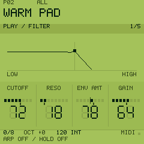

# SY1

SY1 is a polysynth for the M-VAVE FM-1 that plays Synth1 patches. This manual explains the screen, the pages,
how to get patches into the FM-1, and MIDI. Version **0.3.1** includes 500 community factory presets plus NORD, GREEN LED and GREEN LCD display styles.

---

## Contents

1. Install
2. The screen
3. Patches
4. Pages and editing
5. Loading your own patches
6. MIDI
7. What differs from Synth1
8. Troubleshooting

---

## 1. Install

To try it first, open the emulator. It runs the same code in your browser, with sound.

To install, open the installer in Chrome or Edge with the FM-1 connected by USB, and follow it. Back up what
you want to keep from the firmware you have now: SY1 keeps its settings and patches in the same part of the
flash, and overwrites what another firmware left there. The installer can put M-VAVE's own firmware back.

After installation, this release reports the full USB identity **FM-1_51000301**.

## 2. The screen

The patch number, browsing category and patch name stay at the top. EDIT and the SAVE light mean that the
patch differs from the saved version. Turning every value and the patch category back to their saved settings
clears EDIT again. Short save and error messages appear in the red strip without hiding the patch name.

The red strip names the current subpage and its position, such as FILTER / MAIN 1/2. The large diagram below it
shows that section's settings. Four fixed columns correspond left to right to KNOB1–KNOB4. The last encoder
you turn lights amber; a small grey notch marks its saved value. A new subpage starts without encoder focus.
Switches and choices use separate positions; a centred parameter has a centre mark.

Filter shapes, oscillator waveforms and effect diagrams are schematic setting views. The envelope's moving point
follows the most recently started voice through its release, the LFO point follows its actual phase/value,
and the arp shows the current step/note. Random LFOs show recent values. These are not audio oscilloscopes.

Values use meaningful units where the engine supplies a reliable conversion: attack in ms or s, pitch in semitones
and cents, sustain in percent and LFO speed in Hz or exact fractions of a beat. D.TAU, R.TAU and M.TAU are decay
and release **time constants**, not the total duration of a note. Pulse width shows the duty of the low part
(50% at its maximum). Other values keep their Synth1 numbers. GLO's DIAGNOSTIC subpage shows CPU,
peak CPU, voice-limit events and the raw value of the last edited Synth1 parameter. Its four encoders are read-only.

The bottom always shows active/max voices, octave, tempo and its source: INT for internal, EXT for MIDI clock.
MIDI lights briefly when a note arrives. The second line explicitly shows ARP ON/OFF, HOLD ON/OFF or
DRONE / STACK or REPLACE. LIMIT means that the CPU has reduced the voice limit during this session.

### Choosing a display style

On **GLO → DISPLAY (6/6)**, turn **KNOB1** to choose **NORD**, **GREEN** (LED) or **LCD**. The change is immediate.
NORD keeps the red section strip, ivory text and amber focus. GREEN LED uses a dark green background,
uppercase 5×7 pixel lettering and seven-segment numerals. GREEN LCD reverses the contrast with dark
characters and graphics on a soft green background; the focused control gets a lighter panel and dark
underline. Units, patch names, saved-value marks,
encoder focus, graphs, playing status and live envelope/LFO feedback remain available in all three styles.
The screen reader keeps the original text and announces the style choice.

Compare every page in the [screen gallery](https://fenderberg.github.io/fm1-sy1/manual/screens/): 32 subpages in all three styles.

This is a global preference, separate from the sound. It is automatically saved when the synth is idle;
existing patch edits and imported banks are preserved. Upgrading from older 12-byte settings keeps the
selected patch, octave, voice limit, tempo, category and drone preference, and starts in NORD.

## 3. Patches

Turn ALGORITHM to choose a category, and PRESETS for the next or previous patch within it. Both wrap at the
ends. Empty categories are skipped. ALL contains every patch; USER contains every patch in the user bank. FACTORY contains the 500 bundled community presets.
The musical categories are BASS, PAD, LEAD, KEYS, PLUCK, ARP, FX and OTHER.

**500 community presets are ready from the first boot**, numbered **F001–F500**. From ALL, turn
**ALGORITHM left once to FACTORY**, then use PRESETS. No import or USB transfer is needed.

These presets live in program flash and leave the 1,024 user slots available. Existing user slots,
stored selections and MIDI program numbers are preserved when upgrading.

`P01` to `P08` are the eight original built-in sounds. Your own patches are numbered `001` to `1024`;
empty slots are skipped. From the manager, the slot count always refers to these user slots.

SAVE keeps the patch with your changes. An original or factory patch is saved as a copy to the first free user slot, keeping the built-in original. REC puts
the patch back as it was saved and releases hold/drone. Changing patches also releases hold/drone.

Imported patches are categorized from their names, ignoring case (for example, "deep bass", "Warm Pad" and
"FM Bell"). Unrecognized names go under OTHER. To correct a category, use GLO (Voice), SELECT to row 4,
then KNOB3 (CAT), and SAVE. Editing CAT returns the browser to ALL. KNOB4 on that row selects the Drone mode.
MIDI program changes select their original patch number; if necessary the browser returns to ALL.

## 4. Pages and editing

| Button | Page | What is on it |
| --- | --- | --- |
| HOME | Play | Filter frequency, resonance and amount, gain; portamento, pan, tempo, voices |
| EDIT | Osc | Both oscillators, mix, pulse width, sync, ring, FM, detune, the sub, the mod envelope |
| SEL | Filter | Type, frequency, resonance, envelope amount, keyboard tracking, saturation |
| ENV | Env | The amp envelope, the filter envelope, gain and velocity |
| LFO | LFO | Both LFOs: destination, wave, speed, depth, tempo and key sync |
| FX | Effects | The effect, the equalizer, the delay and the chorus |
| Hold ARP 0.5 s | Arp | The arpeggiator: on, type, range, beat, gate, tempo; Drone mode |
| GLO | Voice | Poly, mono or legato, portamento, bend range, unison, polyphony, pan |

Press a page's button again for its next subpage (hold again for ARP), or turn SELECT to choose one. Each page
remembers its last subpage during the session. KNOB1 to KNOB4 change the four displayed values; a fast turn goes
further. This navigation memory is not written to flash. A restart begins on HOME.

The screen reader announces the subpage and the same displayed value/unit when you turn a knob. Read whole
screen also includes the four controls and the current playing state. Animations do not generate spoken updates.

PLAY silences every note. OCT- and OCT+ move the keys by an octave. Pressed together they switch between standard
and bitimbral (below).

### Arp, HOLD and Drone

- **Tap ARP:** switch the arpeggiator on or off from any page. Its light shows on/off, including on the Arp page.
  Hold ARP for half a second to open its settings without toggling it. Hold again to advance the row.
- **SEQ with arp on:** toggle HOLD. Notes keep arpeggiating after key-up. Notes added while any key is down
  belong to the same chord; after all keys are up, the next gesture replaces it.
- **SEQ with arp off:** toggle Drone. In **STACK**, notes accumulate; play a droning note again to remove it.
  In **REPLACE**, the next gesture after all keys are up replaces the previous chord. The old chord uses its
  release envelope, and the new chord its attack; available polyphony still limits overlapping voices.
- **Change Drone mode:** Arp row 2, KNOB3, or Voice row 4, KNOB4. The setting is remembered.
- Switching ARP while SEQ is lit changes the held chord between arpeggiation and Drone.
- Toggle SEQ off to release latched notes; physical keys and the sustain pedal keep their own notes.
  PLAY, MIDI Stop, MIDI All Notes Off and MIDI All Sound Off clear the latch. Hold/drone never resumes at power-on.

These controls work with the FM-1 keys and incoming MIDI. A Drone keeps notes held, so a patch with zero amp
sustain still decays naturally. There is no sequencer or note recording.

VOICES, on the Play and Voice pages, is the most voices SY1 plays at once, 1 to 16. The FM-1 manages about
seven. When the processor runs out of time, SY1 lowers it by one and says CPU FULL.

### Bitimbral: two sounds, for a Novation Circuit Tracks

SY1 has two modes. **Standard** is one sound on every MIDI channel. **Bitimbral** is two parts, **L** and **R**,
each with its own patch, arpeggiator, HOLD/Drone and effects. It is made for the Circuit Tracks' two MIDI tracks
and two audio inputs, and works with any sequencer or keyboard.

| Control | What it does |
| --- | --- |
| **OCT- and OCT+ together** | Standard or bitimbral |
| **OCT-** (tap, in bitimbral) | The panel and the keys on part **L**. OCT- lights, PLAY is green |
| **OCT+** (tap, in bitimbral) | The panel and the keys on part **R**. OCT+ lights, PLAY is red |
| OCT- or OCT+ held half a second (in bitimbral) | The octave |
| GLO, last subpage (7), KNOB1 | MODE: standard or bitimbral |
| GLO, last subpage, KNOB2 | OUTPUT: SPLIT, STEREO or DOUBLE |
| GLO, last subpage, KNOB3 and KNOB4 | The MIDI channels of L and R (3 and 4 to begin with) |

The three outputs:

- **SPLIT:** part L on the left output only, part R on the right only, each in mono, effects included. With a
  stereo-to-two-mono cable each part reaches its own input of the Circuit, to mix and mute there.
- **STEREO:** both parts in stereo on both outputs.
- **DOUBLE:** every note plays both parts at once, in stereo: two patches layered.

Everything the panel does (PRESETS, ALGORITHM, the pages, ARP, SEQ, SAVE, REC) acts on the part it is on; the top
of the screen shows `L` or `R` and the output. The parts are two synths: each keeps its own patch, category,
octave, VOICES limit, Drone mode and the page the panel was on. Only the tempo is shared. Each part plays up to VOICES voices: part R is rendered by the
FM-1's second processor core, so a second sound does not take voices from the first. On an FM-1 whose second core
does not run, the two parts share one core and the overload protection lowers VOICES as usual. Part R's delay
line is half as long as part L's: an echo longer than 0.37 s plays at half its time. The mode, the output, the
channels and both patches are remembered. Changing the mode, the output or a channel stops the notes.

**The Circuit's eight knobs.** In bitimbral, with the Circuit Tracks' factory MIDI template on its MIDI tracks,
each macro knob moves what its label says on the part of its channel. The knob in the middle is the patch as it
is; turning either way adds to it or takes from it, and a new patch starts from the middle again. The screen
names the knob, what it moves and the value.

| Circuit knob | Controller | SY1 |
| --- | --- | --- |
| 1 OSCILLATOR | 1 | The balance of the two oscillators |
| 2 OSC MOD | 2 | Detune: the detuned copies, and oscillator 2 a little |
| 3 AMP ENV | 5 | Amp release and decay (the attack stays) |
| 4 FILTER ENV | 11 | Filter envelope amount, and a little of its decay |
| 5 FILTER FREQ | 71 | Cutoff |
| 6 RESONANCE | 74 | Resonance |
| 7 MODULATION | 12 | LFO 1's depth (above the middle LFO 1 is switched on) |
| 8 FX | 13 | The delay's level (above the middle the delay is switched on) |

In standard mode these controllers do what the patch routes them to, as before.

## 5. Loading your own patches

The Patch Manager on SY1's website has two halves: the **Library** on the left, with **3,174 community
sounds in 27 banks**, and **My FM-1** on the right, with your 1,024 user slots. Everything you do there is
staged in the browser first. Nothing reaches the FM-1 until you press **Sync**.

**Finding sounds.** Search by name or bank, pick a bank, and narrow by character with the coloured chips
(the counts follow your search). Character is inferred from names, so it is a starting point rather than a
guarantee. **★ Favourites** are remembered in this browser; **Not on my FM-1** hides what you already have,
and a green slot number beside a sound shows where it already lives. Click **▶** to hear a sound: the
browser synth switches on inside the page and plays a short phrase. With the list focused, **↑ ↓** move
through it and **Space** plays. Preview uses the separate emulator; it never sends patches to USB hardware.

To bring your own collection, use **Import**, or drop `.sy1` files, folders and ZIPs on the page. ZIPs
containing other bank ZIPs work too. Even the complete supplied collection (175 banks / 16,698 patch
entries) can be browsed locally. Imports remain in this tab until it is closed or reloaded and are not
uploaded.

**Connecting.** Connect the FM-1 by USB, open the manager in Chrome or Edge, press **Connect**, and allow
MIDI with SysEx. The manager reads every user slot whole, so it can move a patch you made on the FM-1 as
easily as one from the library. Sounds you added before connecting wait, and go after your last patch.

**Arranging your FM-1.** The map shows all 1,024 slots, one square each, coloured by character; click a
square to jump to that slot. In the list below it you can:

- drag sounds from the library onto a slot, or select them and press **Add to FM-1**;
- drag slots to reorder them (later patches move down into the next gap), or select some and use **Move to slot**;
- double-click a name to rename it (23 characters), and choose its character, which the FM-1 uses for
  category browsing;
- remove patches with **✕**, **Delete**, or **Arrange → Remove everything**;
- tidy up with **Arrange**: close gaps, group by character, sort A–Z or group by bank.

Shift-click and Ctrl-click select several; Ctrl+A selects all, Ctrl+Z undoes, `/` jumps to the search box.
**Show empty slots** and **Changes only** filter the list.

**Syncing.** The bar at the bottom says what will change: added, moved, edited and removed patches, and how
many slots will be written. **Undo** and **Discard all** cost nothing, because the FM-1 has not been touched
yet. **Sync** writes slot by slot, each acknowledged, with progress; **Stop** stops between acknowledged
writes and leaves the rest staged. Removing patches asks for confirmation first. If a slot is not
confirmed, press **Read again** before retrying. The 500 factory presets and the eight original sounds are
never affected. Turn PRESETS past the built-in patches to play your slots.

**Sets.** A set is a saved layout of all your slots, kept in this browser: one for the stage, one for the
studio. Load a set to stage it, then sync. Before a sync that moves, changes or removes patches, the manager
saves the old layout as **Auto-backup before last sync**. Export a set as a file to keep a backup outside
the browser, and import it again later.

**Bitimbral in the manager.** With an FM-1 connected, the strip under its name switches between **Standard**
and **Bitimbral** and, in bitimbral, chooses the output (**Split**, **Stereo**, **Double**); it also shows each
part's MIDI channel and the slot it plays. Each slot in the list has an **L** and an **R** button (one ▶ in
standard mode) that make the FM-1 play that slot on that part straight away, with any of the 1,024 slots. The
map rings part L's slot in green and part R's in red, as the FM-1's PLAY light shows the part. A slot you have
only staged plays after you sync it.

To find two sounds that work together, press **L** beside a sound in the library: it becomes part L. Every ▶
after that plays the other sound as part R together with it, a bass line on L under chords on R, as on a
Circuit. **Add pair** stages both side by side; after syncing, press L and R on the two slots. **✕** ends the
pairing.

An FM-1 running SY1 0.3.1 or earlier can only report patch names. The manager then still adds and removes
sounds, but reordering, renaming, Arrange and Sets need a newer SY1.

The collection comes from [Internet Archive](https://archive.org/details/synth1_202202); its metadata credits
the compilation to techno-addicts. Our count of the supplied ZIP is 175 banks / 16,698 patch entries.

Use the manager's **Factory 500** filter to preview the included sounds. The [downloadable selection](https://fenderberg.github.io/fm1-sy1/library/factory500.zip) contains the original patch files and complete original readmes.

Each hosted bank keeps its original ZIP, readme, author credits and distribution terms in **About this bank**.
These presets have their authors' own terms, separately from the code's MIT license. The full supplied
collection contains banks that restrict redistribution; those can be imported locally but are not hosted.
Patches from older Synth1 versions are converted as Synth1 itself converts them.

## 6. MIDI

MIDI comes in over USB and the TRS jack. SY1 plays notes with velocity, pitch bend, the sustain pedal and
channel pressure. The modulation wheel and other controllers do what the patch routes them to. A program change
selects the patch of that number. A MIDI clock sets the tempo of the arpeggiator, the delay and the LFOs that
are synced to the tempo. After two seconds without clock ticks SY1 returns to the internal tempo.
MIDI Stop releases all notes and disables hold/drone. With a clock coming in, the arpeggiator steps on the clock
itself, counted from MIDI Start: it stays on the sequencer's grid, a new chord begins on the next step, and Start
plays the pattern from its top.

In standard mode SY1 listens on every channel. In bitimbral, part L listens on channel 3 and part R on channel 4
(the Circuit Tracks' MIDI 1 and MIDI 2; GLO's last subpage changes them) and other channels are ignored. In DOUBLE
the notes of either channel play both parts; controllers, pitch bend and program changes stay with their part.

The FM-1's own keys also go out as notes over USB.

## 7. What differs from Synth1

SY1 follows Synth1's structure and its measured parameter laws, but it is a lighter engine made for the FM-1,
not an exact copy:

- The LPDL filter plays as the 24 dB filter, and the effect a.d.1 uses a.d.2's curve.
- The delay is 0.74 seconds a side at most; a longer time plays an octave shorter.
- With the delay and the chorus both on, the echoes also reach the output directly.
- Osc1's detune does not thicken the sub.
- It plays about seven voices, where Synth1 plays up to 32.

## 8. Troubleshooting

- **The sound breaks up on big chords.** Lower VOICES on the Voice page.
- **The Patch Manager finds no FM-1.** Use Chrome or Edge, allow MIDI for the page, and check the USB cable
  carries data. Close other programs that hold the FM-1's MIDI port.
- **A patch sounds different from Synth1.** See section 7; reports with the patch are welcome at the source's
  issue tracker.
- **To go back to another firmware,** use that firmware's installer, or SY1's installer for M-VAVE's own.
